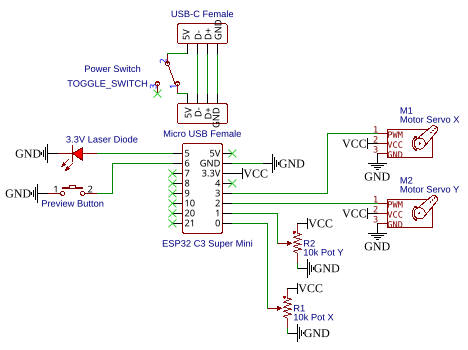

# Random Laser Pointer

## Design Requirements

Random laser pointer station. Embedded Rust

- Laser moves randomly.
- Configurable `x` and `y` area of laser movement.
- Manual laser control from a phone over WiFi.
- Simple USB-C connector for power and programming.

## Hardware

- 1 x [ESP32 C3 SuperMini](https://www.espressif.com/en/products/socs/esp32-c3)
- 1 x 3.3V Laser diode
- 2 x [SG90 servo motor](/datasheets/SG90_servo_motor.pdf) to position the laser
- 2 x 10kΩ potentiometer to control the servo X and Y range
- 1 x Latching button to preview the laser area
- 1 x Toggle switch to control power
- 1 x USB-C Female connector for power and programming
- 1 x 3D printed case


## Wiring



## Operating modes

The latching preview button doubles as a boot-time mode switch. The firmware reads it once at startup:

- Unlatched at boot: random mode. The laser walks randomly inside the bounding box set by the two potentiometers, and latching the button previews the box corners. After 10 minutes of runtime the unit deep sleeps for 20 minutes, then wakes and repeats.
- Latched at boot: manual mode. The firmware starts a WiFi access point and serves a web D-pad, described below. The potentiometers and the button are ignored, and the unit never deep sleeps.

To switch modes, set the button and power cycle.

## Manual control over WiFi

Booting with the preview button latched starts an open WiFi access point with a DHCP server and serves a web D-pad for driving the laser by hand across the full servo range.

1. Join the `laser-dpad` WiFi network and keep the connection when the phone warns about no internet.
2. Open <http://192.168.2.1/> (plain `http`, browsers that force `https` will hang).
3. Hold a direction button to glide the laser. The center tile shows the round-trip time of each command.

- The page keeps one persistent HTTP connection so commands avoid a TCP handshake, and a held button re-sends its direction every 120 ms as a keepalive.
- The firmware stops all movement if no command arrives for 350 ms, so a lost release packet cannot leave a servo running away.
- `RAMP_COUNTS_PER_SEC` in `src/manual/mod.rs` sets the glide speed.

## Development Environment

This project is built in a `no_std` environment utilizing the `esp-hal` crate.

The ESP32-C3 is RISC-V, so the stock stable toolchain works. `rust-toolchain.toml` pins the channel and installs the `riscv32imc-unknown-none-elf` target and `rust-src` on first build, so the only setup is:

- Rust via [rustup](https://rustup.rs/)
- [`espflash`](https://github.com/esp-rs/espflash) to flash and monitor over USB:

```shell
cargo install espflash
```

Build, flash, and stream serial logs until Ctrl-C (the runner is configured in `.cargo/config.toml`):

```shell
cargo run --release
```

## Resources

- [The Rust on ESP Book](https://docs.esp-rs.org/book/introduction.html)

## Final Product

<!-- TODO: Final product image -->

## Future work

- [ ] Add 'programmer' support for an external module with a little screen and joystick that can be plugged into the main station to program key settings:
  - [ ] Speed
  - [ ] Bounding box
- [ ] Design ergonomic enclosure for programmer
- [ ] Upgrade to bigger, more robust, servos
- [ ] Redesign main enclosure with wall mounting keyholes
- [ ] Take final product image
