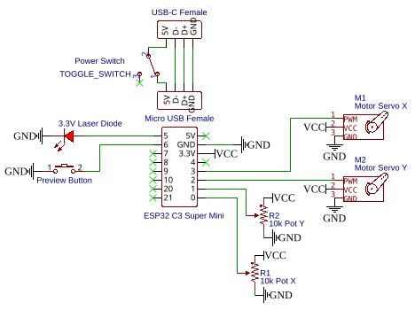

# Random Laser Pointer

## Design Requirements

Random laser pointer station. Embedded Rust

- Laser moves randomly.
- Configurable `x` and `y` area of laser movement.
- Manual laser control from a phone over WiFi.
- Simple USB-C connector for power and programming.

## Hardware

- 1 x [ESP32 C3 SuperMini](https://www.espressif.com/en/products/socs/esp32-c3)
- 1 x 3.3V Laser diode
- 2 x [SG90 servo motor](/datasheets/SG90_servo_motor.pdf) to position the laser
- 1 x Toggle switch to control power
- 1 x USB-C Female connector for power and programming
- 1 x 3D printed case


## Wiring



> Note: the schematic still shows the two potentiometers and the preview button. The firmware no longer reads them, and the schematic update is tracked in Future work.

## Operating modes

The station boots into Random with the `laser-dpad` access point and web page always up. Switch modes from the page at any time:

| Mode | Laser | Servos |
|------|-------|--------|
| Random, active | on | random walk inside the room preset's box |
| Random, rest | off | hold position |
| Manual | on | D-pad glide across full servo travel |
| Off | off | hold position |

- Random alternates 10 minutes active with 20 minutes rest. Entering Random from another mode restarts at the start of an active phase.
- Any D-pad press switches to Manual. Leaving Manual takes a mode button.

## Manual control over WiFi

The station runs an open WiFi access point with a DHCP server and serves a page with three mode buttons and a D-pad.

1. Join the `laser-dpad` WiFi network and keep the connection when the phone warns about no internet.
2. Open <http://192.168.2.1/> (plain `http`, browsers that force `https` will hang).
3. Tap Random, Manual, or Off. Hold a direction button to glide the laser. The center tile shows the round-trip time of each command.

- The page keeps one persistent HTTP connection so commands avoid a TCP handshake, and a held button re-sends its direction every 120 ms as a keepalive.
- The firmware stops all movement if no command arrives for 350 ms, so a lost release packet cannot leave a servo running away.

The page polls `GET /status` for the current mode. The same API takes every tuning value and four named room presets:

```shell
curl 'http://192.168.2.1/status'                                  # mode, phase, position, all settings as JSON
curl 'http://192.168.2.1/mode?m=off'                              # random, manual, or off
curl 'http://192.168.2.1/set?preset=1&name=Bedroom&x_min=900'     # switch preset, then edit its name and box
curl 'http://192.168.2.1/set?manual_speed=600&rest_min=0'         # rest_min=0 disables the rest phase
```

`/set` keys: `preset`, `name`, `x_min`, `x_max`, `y_min`, `y_max`, `glide_min_us`, `glide_max_us`, `dwell_min_ms`, `dwell_max_ms`, `manual_speed`, `active_min`, `rest_min`. Out-of-range values clamp and reversed min/max pairs swap. An unknown key or unparsable value applies nothing and answers 400.

Settings and the active preset persist across power cycles and reflashing. They are saved 2 s after the last `/set` to the `settings` partition in `partitions.csv`, which sits outside the first 64 KB that every flash rewrites. The mode is not saved, so the station always boots into Random.

## Development Environment

This project is built in a `no_std` environment utilizing the `esp-hal` crate.

The ESP32-C3 is RISC-V, so the stock stable toolchain works. `rust-toolchain.toml` pins the channel and installs the `riscv32imc-unknown-none-elf` target and `rust-src` on first build, so the only setup is:

- Rust via [rustup](https://rustup.rs/)
- [`espflash`](https://github.com/esp-rs/espflash) to flash and monitor over USB:

```shell
cargo install espflash
```

Build, flash, and stream serial logs until Ctrl-C (the runner is configured in `.cargo/config.toml`):

```shell
cargo run --release
```

Without a board, `cargo run --target aarch64-apple-darwin --no-default-features --features sim --bin sim` runs the same controller and page on the Mac at port 8080, with a room view at `/sim`.

## Resources

- [The Rust on ESP Book](https://docs.esp-rs.org/book/introduction.html)

## Final Product

<!-- TODO: Final product image -->

## Future work

- [ ] Phone UI rebuilt around the settings API: D-pad, laser toggle, random start/stop and speed, room preset picker and box editor
- [ ] Configurable on/off schedule replacing the fixed active/rest cycle
- [ ] Update the schematic to drop the potentiometers and preview button
- [ ] Bench checklist, once a board is on hand:
  - [ ] Boots into Random with the AP up, the page loads, the D-pad takes over, and the mode buttons work
  - [ ] Rest phase with a shortened `rest_min`: laser off, servos hold, and the page still reachable
  - [ ] Random-mode stepping doesn't starve the network (D-pad latency comparable to the old manual mode)
  - [ ] Heap and stack fit with WiFi and the controller running together
  - [ ] Settings and the active preset survive a power cycle and a `cargo run` reflash
  - [ ] Settings save during Manual causes at most a brief glide stop
- [ ] Upgrade to bigger, more robust, servos
- [ ] Redesign main enclosure with wall mounting keyholes
- [ ] Take final product image
