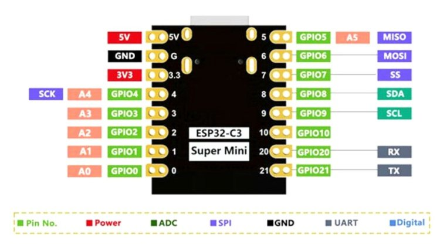
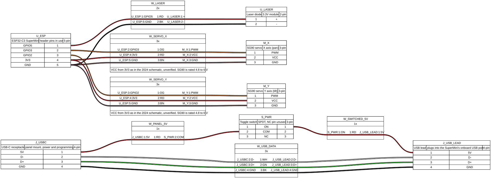

# Random Laser Pointer

## Design Requirements

Random laser pointer station. Embedded Rust

- Laser moves randomly.
- Configurable room outlines that bound the laser's movement.
- Manual laser control from a phone over WiFi.
- Simple USB-C connector for power and programming.

## Hardware

- 1 x [ESP32 C3 SuperMini](https://www.espressif.com/en/products/socs/esp32-c3)
- 1 x 3.3V Laser diode
- 2 x [SG90 servo motor](/datasheets/SG90_servo_motor.pdf) to position the laser
- 1 x Toggle switch to control power
- 1 x USB-C Female connector for power and programming
- 1 x 3D printed case



## Wiring



Source in [`docs/wiring/overview.yaml`](docs/wiring/overview.yaml), regenerate with `mise run wireviz`.

> Note: the servo VCC comes from the 3V3 pin, carried over from the original schematic and not yet checked on the build. SG90s are rated for 4.8 to 6 V.

## Operating modes

The station boots into Random with the `laser-dpad` access point and web page always up. Switch modes from the page at any time:

| Mode | Laser | Servos |
|------|-------|--------|
| Random, active | on | random walk inside the active room's outline |
| Random, rest | off | hold position |
| Manual | on | D-pad glide across full servo travel |
| Off | off | hold position |

- Random alternates 10 minutes active with 20 minutes rest. Entering Random from another mode restarts at the start of an active phase.
- Any D-pad press switches to Manual. Leaving Manual takes a mode button.

## Manual control over WiFi

The station runs an open WiFi access point with DHCP and a captive DNS, and serves one page for steering, modes, rooms, and tuning.

1. Join the `laser-dpad` WiFi network. The page opens in the sign-in sheet, or at <http://laser.pointer/> (plain `http`, browsers that force `https` will hang).
2. Hold any of the 8 D-pad directions to glide the laser. Sliding a held finger onto another button changes direction. The center tile shows the round-trip time of each command.
3. Tap Random, Manual, or Off, or tap the room name to switch rooms. The gear opens glide, pause, phase, and manual speed settings plus the room list.

- The page keeps one persistent HTTP connection so commands avoid a TCP handshake, and a held button re-sends its direction every 120 ms as a keepalive.
- The firmware stops all movement if no command arrives for 350 ms, so a lost release packet cannot leave a servo running away.
- Without a board, the [simulator](#development-environment) serves the same page and API from the Mac.

### Rooms

Each of the four rooms is a name and an outline of up to 16 points, aimed with the laser. Random picks targets inside the outline and travels in straight lines that stay inside it. A room with fewer than 3 points holds Random with the laser off until a third point is saved.

- Opening a room in the editor makes it the active room. Opening a point jumps the laser there, steer it with the D-pad, then Save point here.
- The would-be outline turns red and Save is disabled if it crosses itself.
- Preview traces the outline once, then Random resumes from the first point. Tapping a mode button stops it.

### API

The page polls `GET /status`. The same API takes every tuning value and room outline:

```shell
curl 'http://laser.pointer/status'                                  # mode, phase, idle reason, previewing, position, points per room (counts), active room's points, all settings as JSON
curl 'http://laser.pointer/mode?m=off'                              # random, manual, or off
curl 'http://laser.pointer/d?dir=upleft'                            # up, down, left, right, the 4 diagonals, or stop
curl 'http://laser.pointer/goto?x=900&y=1200'                       # glide straight to a duty-count position in Manual
curl 'http://laser.pointer/set?preset=1&name=Bedroom'               # switch room, then rename it
curl 'http://laser.pointer/points?r=1&p=900,900;1500,900;1500,1500' # replace the active room's outline, empty p clears it
curl 'http://laser.pointer/preview'                                 # trace the active outline
curl 'http://laser.pointer/set?manual_speed=600&rest_min=0'         # rest_min=0 disables the rest phase
```

`/set` keys: `preset`, `name`, `glide_min_us`, `glide_max_us`, `dwell_min_ms`, `dwell_max_ms`, `manual_speed`, `active_min`, `rest_min`. Out-of-range values clamp and reversed min/max pairs swap. An unknown key or unparsable value applies nothing and answers 400. `/points` answers 400 for more than 16 points, unparsable values, or a self-crossing outline, and 409 when `r` is not the active room.

Settings, rooms, and the active room persist across power cycles and reflashing. They are saved 2 s after the last `/set` or `/points` to the `settings` partition in `partitions.csv`, which sits outside the first 64 KB that every flash rewrites. The mode is not saved, so the station always boots into Random.

## Development Environment

This project is built in a `no_std` environment utilizing the `esp-hal` crate.

The ESP32-C3 is RISC-V, so the stock stable toolchain works. `rust-toolchain.toml` pins the channel and installs the `riscv32imc-unknown-none-elf` target and `rust-src` on first build, so the only setup is:

- Rust via [rustup](https://rustup.rs/)
- [`espflash`](https://github.com/esp-rs/espflash) to flash and monitor over USB:

```shell
cargo install espflash
```

Build, flash, and stream serial logs until Ctrl-C (the runner is configured in `.cargo/config.toml`):

```shell
cargo run --release
```

Without a board, `cargo run --target aarch64-apple-darwin --no-default-features --features sim --bin sim` runs the same controller and page on the Mac at port 8080, with a room view at `/sim`.

## Resources

- [The Rust on ESP Book](https://docs.esp-rs.org/book/introduction.html)

## Final Product

<!-- TODO: Final product image -->

## Future work

- [x] Phone UI rebuilt around the settings API: 8-way D-pad, mode switch, settings sheet, room picker and outline editor
- [x] Replace the schematic with a WireViz diagram without the potentiometers and preview button
- [ ] Bench checklist, once a board is on hand:
  - [ ] Confirm the servo VCC source, and move the servos to 5V if they run on 3V3
  - [ ] Boots into Random with the AP up, the page loads, the D-pad takes over, and the mode buttons work
  - [ ] Rest phase with a shortened `rest_min`: laser off, servos hold, and the page still reachable
  - [ ] Random-mode stepping doesn't starve the network (D-pad latency comparable to the old manual mode)
  - [ ] Heap and stack fit with WiFi and the controller running together
  - [ ] Settings and the active preset survive a power cycle and a `cargo run` reflash
  - [ ] Settings save during Manual causes at most a brief glide stop
  - [ ] Captive sign-in sheet opens the page on iOS and Android
  - [ ] `laser.pointer` resolves on the phone
  - [ ] Live outline in the point editor keeps up at 150 ms polling
  - [ ] Page loads quickly from flash
- [ ] Upgrade to bigger, more robust, servos
- [x] Redesign main enclosure with wall mounting keyholes
- [ ] Take final product image
